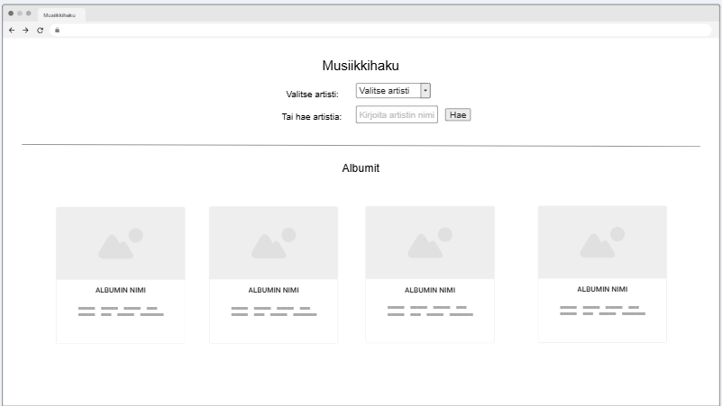
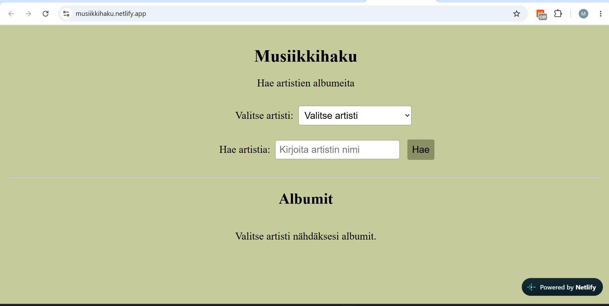
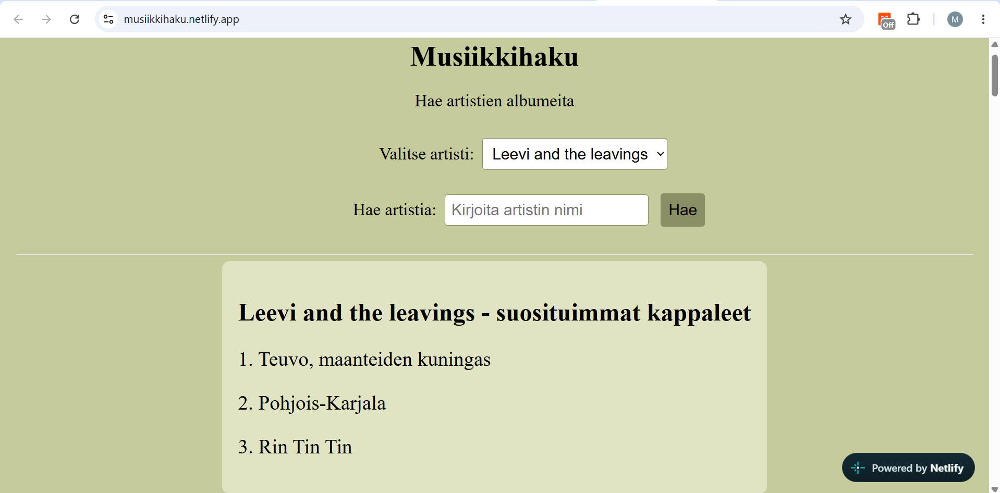
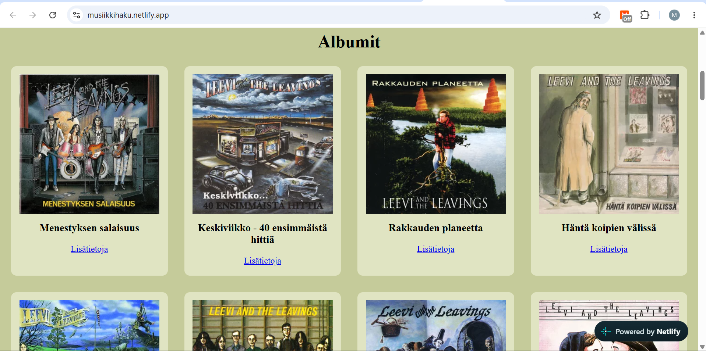

# Musiikkihaku

**Tekijä:** Mikaela Grundström

## Projektisuunnitelma

### Projektin idea

Musiikkihaku on sovellus, jonka avulla käyttäjä voi etsiä artistien albumeita Last.fm-palvelun kautta. Käyttäjä voi valita artistin sivulla olevasta listasta tai itse hakukentän avulla. Sovellus näyttää myös artistin top 3 - kappaletta. Sovellus on tarkoitettu kenelle tahansa, joka haluaa käydä läpi jonkun artistin albumeita.

### Suunnitellut toiminnot

- Artistin valinta alasvetovalikosta
- Artistin haku hakukentällä
- Albumien kuvien ja nimen näyttäminen
- Artistin suosituimpien kappaleiden näyttäminen
- Linkki albumin lisätietoihin

### Rautalankamalli / luonnos

## Verkkolinkit

- **Julkaistu sovellus:** (https://musiikkihaku.netlify.app/)
- **GitHub-repositorio:** (https://github.com/mikaelalinnea/musiikkihaku)
- **Projektin videoesittely:** [Lisää tähän videon osoite](https://example.com/)

## Tietoja sovelluksesta

**Musiikkihaku** on verkkosovellus, joka hyödyntää Last.fm APIa eri musiikkitietojen hakemiseen. Käyttäjä voi etsiä artisteja, jolloin sivulla näkyy sen artistin albumit sekä suosituimmat kappaleet. Sivulta pääsee myös jokaisen albumin kohdalta linkin kautta katsomaan lisätietoja albumista, kuten kappaleet. Sovellus hyödyntää Netlify API-avaimen suojaamiseen.

## Teknologiat

- HTML – sivun rakenne
- CSS – ulkoasu ja asettelu
- JavaScript – toiminnallisuus ja API-kutsut
- Last.fm API - artisti ja albumitiedot
- Netlify - sovelluksen julkaisu, API-avaimen suojaaminen

## Sovelluksen käyttö

1. Avaa julkaistu sovellus yllä olevasta linkistä.
2. Valitse artisti alasvetovalikosta tai kirjoita artistin nimi hakukenttään.
3. Hae artisti listasta tai paina Hae.
4. Sovellus näyttää artistin albumit sekä kolme suosituinta kappaletta.
5. Lisätietoja-linkistä pääsee Last.fm albumisivulle.

## Sovelluksen käynnistäminen paikallisesti

1. Kloonaa tai lataa tämä repositorio omalle koneellesi.
2. Avaa projektikansio.
3. Lisää oma Last.fm API-avain Netilfyn ympäristömuuttujiin.
4. Käynnistä projekti Netlify Dev-ympäristössä.
5. Avaa sovellus selaimessa.

## Kuvakaappaukset

## Tunnetut virheet / puutteet

 **Ei tunnettuja virheitä.**

## Oma arvio ja oppimisen reflektointi

Pohdi työtäsi ja oppimisprosessiasi.

- Onnistuin toteuttamaan toimivan verkkosovelluksen, joka hyödyntää Last.fm APIa. Sain toimimaan että käyttäjä pystyy hakea artisteja alasvetovalikosta sekä hakukentän avulla. Sovellus näyttää albumit, albumikuvat sekä artistin suosituimmat kappaleet.
- Haastavinta oli Last.fm API:n käyttöönotto, API-kutsujen rakentaminen ja Netlifyn käyttö.
- Jos olisi enemmän aikaa, lisäisin sivulle enemmän lisätietoja.
- Projektin aikana opin käyttämään Last.fm APIa ja käsittelemään JSON muotoista dataa JavaScriptissä. Opin paremmin API-kutsujen tekemistä ja tiedon näyttämistä sivulla. Opin myös suojaamaan API-avaimen Netlifyn kautta.
- Haluaisin oppia lisää API-rajapinnoista ja niiden käytöstä, enemmän Netlifyn käytöstä sekä miten frontend ja backend toimivat yhdessä verkkosovelluksissa.
- Oma arvio projektista: **8/10 pistettä**

## Lähteet ja kiitokset

- Kurssimateriaali & aikaisemmat workshopit.
- [Last.fm/api](https://www.last.fm/api)
- Käytetty tekoälytyökalu: Microsoft Copilot
  - Tekoälyä on käytetty koodin virheiden etsimiseen jos jokin toiminto ei toiminut oikein sekä koodin siistimiseen. Tekoäly myös kirjoitti README.md "Sovelluksen käynnistäminen paikallissesti", sillä en ollut ihan varma miten se tehdään.

  ## Lisenssi

Tämä projekti on lisensoitu MIT-lisenssillä.